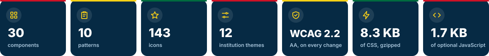
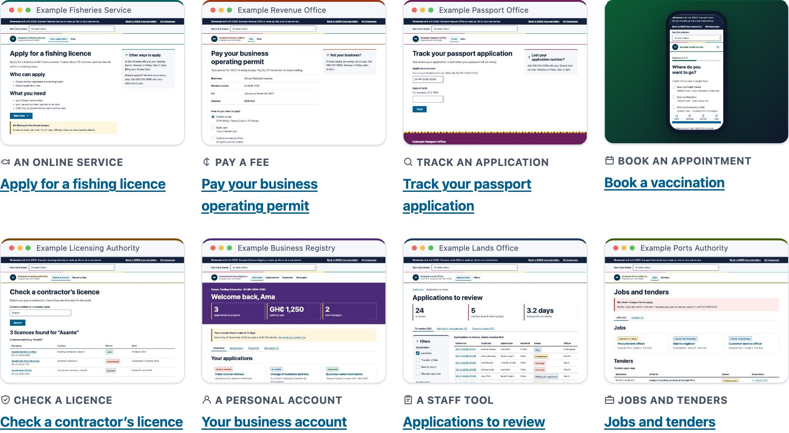
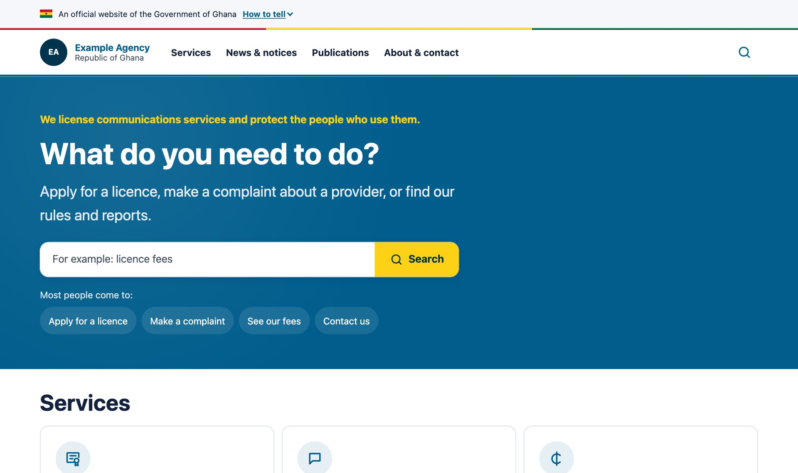
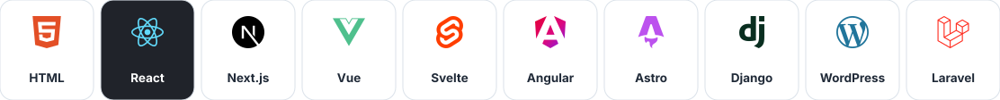
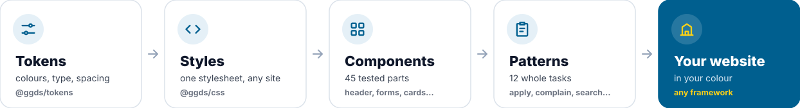
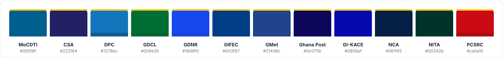

<p align="center">
  <a href="https://ghana-gds.github.io/ggds/"></a>
</p>

<p align="center">
  <a href="https://github.com/ghana-gds/ggds/actions/workflows/ci.yml"></a>
  <a href="https://www.npmjs.com/org/ggds"></a>
  <a href="https://pypi.org/project/ggds-django/"></a>
  <a href="https://ghana-gds.github.io/ggds/accessibility.html"></a>
  <a href="LICENSE.md"></a>
</p>

<p align="center">
  <b><a href="https://ghana-gds.github.io/ggds/">Documentation</a></b> ·
  <b><a href="https://ghana-gds.github.io/ggds/get-started.html">Get started</a></b> ·
  <b><a href="https://ghana-gds.github.io/ggds/get-started/tutorial.html">Tutorial</a></b> ·
  <b><a href="https://ghana-gds.github.io/ggds/components/index.html">Components</a></b> ·
  <b><a href="https://ghana-gds.github.io/ggds/showcase/index.html">Showcase</a></b> ·
  <b><a href="https://ghana-gds.github.io/ggds/showcase/index.html#starter-h">Download a website</a></b>
</p>

---

**GGDS is the shared way to build Government of Ghana websites and services.** It gives every ministry,
department and agency the same tested building blocks (styles, page parts, forms, icons and guidance), so that
every government website looks familiar, works on a low-cost phone on a slow connection, and can be used by
everyone, including disabled people.

Use it with plain HTML or any framework. Give it your institution's colour. Spend your time on your service, not
on rebuilding a header for the hundredth time.

<p align="center"></p>

## See what you can build

The things government institutions build again and again, made with GGDS. Each is a working example you can click
through, read the code of, and copy.

<p align="center"><a href="https://ghana-gds.github.io/ggds/showcase/index.html"></a></p>

| Example | What it shows |
|---|---|
| [Apply for a licence](https://ghana-gds.github.io/ggds/showcase/apply-start.html) | Start page, questions, check your answers, confirmation and what happens next |
| [Pay a fee](https://ghana-gds.github.io/ggds/showcase/pay.html) | What you owe, mobile money (and "we never ask for your PIN"), a receipt |
| [Track an application](https://ghana-gds.github.io/ggds/showcase/track.html) | Enter a reference, see every step on a timeline |
| [Book an appointment](https://ghana-gds.github.io/ggds/showcase/book.html) | Made for a phone: a place, a time, a booking code |
| [Check a licence](https://ghana-gds.github.io/ggds/showcase/check.html) | A public register people can search, with a way to report fakes |
| [Personal account](https://ghana-gds.github.io/ggds/showcase/account.html) · [Staff tool](https://ghana-gds.github.io/ggds/showcase/staff.html) · [Jobs and tenders](https://ghana-gds.github.io/ggds/showcase/jobs.html) | Both sides of a service, and what every institution publishes |

Every example lists the GGDS parts it is built from and what your team still has to build behind it.

## Download a whole website

<a href="https://ghana-gds.github.io/ggds/starter/index.html"></a>

**The agency website starter** is a complete website for a made-up institution: 20 pages, including a homepage,
services, a licence application from start to confirmation, a complaint form, news, publications, jobs, about,
contact, search and an accessibility statement. Forms check their answers, search works, and none of it needs a
server. Change the name, the theme and the words, and put it online.

**[See it working](https://ghana-gds.github.io/ggds/starter/index.html)** ·
**[Download it](https://github.com/ghana-gds/ggds/releases/latest)** (`ggds-agency-starter-<version>.zip`, with every release)

## Start in one minute

Put two lines in the `<head>` of any page:

```html
<link rel="stylesheet" href="https://cdn.jsdelivr.net/npm/@ggds/css@0.3.0/dist/ggds.min.css">
<script type="module" src="https://cdn.jsdelivr.net/npm/@ggds/js@0.3.0/dist/auto.js"></script>
```

Then copy the HTML for any part from the [components](https://ghana-gds.github.io/ggds/components/index.html). For a
live government website, serve the files yourself: download `ggds-<version>.zip` from the
[releases](https://github.com/ghana-gds/ggds/releases) and copy its `ggds` folder into your website, or install from
npm. New to GGDS? The [tutorial](https://ghana-gds.github.io/ggds/get-started/tutorial.html) builds a page and a
sign-in form, step by step.

```sh
npm install @ggds/css @ggds/js @ggds/themes   # any website
npm install @ggds/react @ggds/css             # React and Next.js
npm install @ggds/astro                       # Astro
pip install ggds-django                       # Django and Wagtail
```

## Works with your stack

<p align="center"></p>

GGDS is plain HTML and CSS, so it works anywhere that makes web pages. Some frameworks get more:

| You build with | You get |
|---|---|
| **React, Next.js** | [`@ggds/react`](packages/react): page parts and form fields with errors wired up for screen readers, server components where possible, and a JSX version of every example in the docs |
| **Django, Wagtail** | [`ggds-django`](packages/django): one setting renders every form the GGDS way, template tags for each part, and a GGDS theme for Django admin |
| **WordPress** | [The GGDS theme](packages/wordpress): upload the zip, set your institution in the Customiser |
| **Astro** | [`@ggds/astro`](packages/astro): the page parts as components |
| **Vue, Svelte, Angular, Laravel, PHP, Rails…** | The HTML pastes in as it is: [where the styles and script go](https://ghana-gds.github.io/ggds/get-started/developers.html#frameworks) in each |

## How it fits together

<p align="center"></p>

**Tokens** hold every colour, size and space. **Styles** turn them into one small stylesheet. **Components** are
the tested parts: header, banner, forms, error summary, cards, tables and more. **Patterns** put them together into
whole tasks: ask for information, make a complaint, show search results. **Your website** uses all of it, in your
colour.

## Your institution's colour

<p align="center"></p>

A theme changes one thing, the institution's colour, in five places: the line under the header, the name, the
homepage hero, the footer and its card in a list. Links, buttons, forms and messages stay the same on every
government website, so people recognise them wherever they are. Every colour is checked for contrast before it can
be a theme. [Choose your theme](https://ghana-gds.github.io/ggds/themes.html), or make one from your colour.

## Built to a high bar

Every claim here is checked automatically on every change:

- **Everyone can use it.** Every component, pattern and example is tested against WCAG 2.2 AA with
  [axe](https://github.com/dequelabs/axe-core), on desktop and phone. Every colour pair is measured. An audit with
  disabled people in Ghana comes before version 1.0 ([brief](docs/ACCESSIBILITY-AUDIT.md)).
- **Any phone, any connection.** No page scrolls sideways on a 320px screen, even with a wide font. The whole
  system is about 8 KB of CSS and under 2 KB of optional JavaScript, gzipped.
- **Works without JavaScript.** Every part works with the script switched off; the script only adds the phone menu
  and moves focus to errors.
- **Secure by default.** No inline scripts or styles anywhere, so websites can run a strict Content Security
  Policy (`style-src 'self'; script-src 'self'`).
- **One source of truth.** The React and Django parts are compared, element by element, with the HTML the
  documentation tests. Every JSX snippet in the docs is checked to parse, and every React example to type-check.

## Packages

| Package | What it is |
|---|---|
| [`@ggds/css`](packages/css) | The styles for every part, in one file or one per component |
| [`@ggds/js`](packages/js) | The small optional script: phone menu and error summary |
| [`@ggds/themes`](packages/themes) | The ready-made institution themes |
| [`@ggds/tokens`](packages/tokens) | The design tokens as CSS custom properties and W3C JSON, and the colour rule |
| [`@ggds/icons`](packages/icons) | 143 line icons for government services: SVG files, a sprite, JavaScript and JSON |
| [`@ggds/react`](packages/react) | Page parts and form fields as React components, for React and Next.js |
| [`@ggds/astro`](packages/astro) | The page parts as Astro components |
| [`ggds-django`](packages/django) | Template tags, a form renderer, a Django admin theme and the static files |
| [GGDS for WordPress](packages/wordpress) | A WordPress theme, `ggds-wordpress-<version>.zip` from the releases |
| [`@ggds/html`](packages/html) | The HTML and guidance for every component and pattern: the documentation is built from it (not published) |

## Status

**Draft, version 0.3.0.** GGDS is maintained by the National Information Technology Agency (NITA). Version 1.0 will
be NITA guidance, recommended for every government website, after the independent accessibility audit. Until then
names may change; every change is in [`CHANGELOG.md`](CHANGELOG.md), and
[Versions and support](https://ghana-gds.github.io/ggds/versions.html) says how long each version is supported.

## Contribute

Report a problem, share research, or propose a component: see
[Contribute](https://ghana-gds.github.io/ggds/contribute.html). To change the code, see
[`CONTRIBUTING.md`](CONTRIBUTING.md). Everyone follows the [code of conduct](CODE_OF_CONDUCT.md). Report security
problems privately: [`SECURITY.md`](SECURITY.md).

## Develop

Node (the version in `.nvmrc`), pnpm, and [uv](https://docs.astral.sh/uv/) for the Django package.

```sh
pnpm install
pnpm run build        # tokens → icons → themes → css → js → react → django → wordpress → documentation in site/
pnpm run serve        # http://localhost:4173, with a strict Content Security Policy
pnpm test             # build, Django tests, unit tests, then accessibility and behaviour tests (desktop and phone)
pnpm run screenshots  # the showcase pictures, after a build
pnpm run readme:art   # this README's pictures, drawn from GGDS's own icons, themes and sizes
```

### Release

Set the same version in each `packages/*/package.json`, `packages/django/pyproject.toml` and
`packages/django/src/ggds_django/__init__.py`, add it to `CHANGELOG.md`, then push a tag such as `v0.3.0`. The
release workflow tests the build, publishes the npm packages under `@ggds` with provenance and `ggds-django` to
PyPI, and makes a GitHub release with the GGDS zip, the WordPress theme and the agency website starter. The
documentation is published from `main`. Details: [`docs/HANDOVER.md`](docs/HANDOVER.md#release).

### Taking over GGDS

[`docs/HANDOVER.md`](docs/HANDOVER.md) is for the team that maintains GGDS: where everything is, how to build, test
and release it, what has been decided, and what is still open.

## How GGDS was designed

GGDS is built on standards and on what established government design systems have proven with their users:

- **Accessibility.** [WCAG 2.2](https://www.w3.org/TR/WCAG22/) level AA is the baseline, tested automatically, with
  an audit by disabled users before version 1.0.
- **Government design systems.** Where a problem has a well-tested answer, GGDS uses it: the error summary, date
  input, confirmation panel, summary list, disclosure and skip link follow the
  [GOV.UK Design System](https://design-system.service.gov.uk/), and the official-website banner follows the
  [U.S. Web Design System](https://designsystem.digital.gov/components/banner/).
- **Phones first.** Most people in Ghana use the internet on a phone, so every part fits a 320px screen and the
  phone tab bar keeps three to five destinations within reach of a thumb, as
  [Material Design](https://m3.material.io/components/navigation-bar/guidelines) and Apple's
  [Human Interface Guidelines](https://developer.apple.com/design/human-interface-guidelines/tab-bars) advise.
- **Ghana's own rules.** The footer carries the links NITA's Systems and Applications Standard expects on every
  public website.

The organisations in the showcase and the starter are made up. The MoCDTI and agency example sites are published
when the real sites go live: until then `GGDS_AGENCY_SITES=1` builds them from `docs/example-sites.json`
(`pnpm run sync:examples`), with no logos, contact details or web addresses.

## Licence

The code is free to use, change and share under [Apache-2.0](LICENSE). The national flag, the coat of arms and
institutions' logos are not part of the licence: see [`LICENSE.md`](LICENSE.md). Framework logos in this README are
trademarks of their owners, shown to say GGDS works with them; their shapes are from
[Simple Icons](https://simpleicons.org/) (Angular's logo CC BY 4.0, Vue's CC BY-NC-SA 4.0).

<p align="center"></p>
